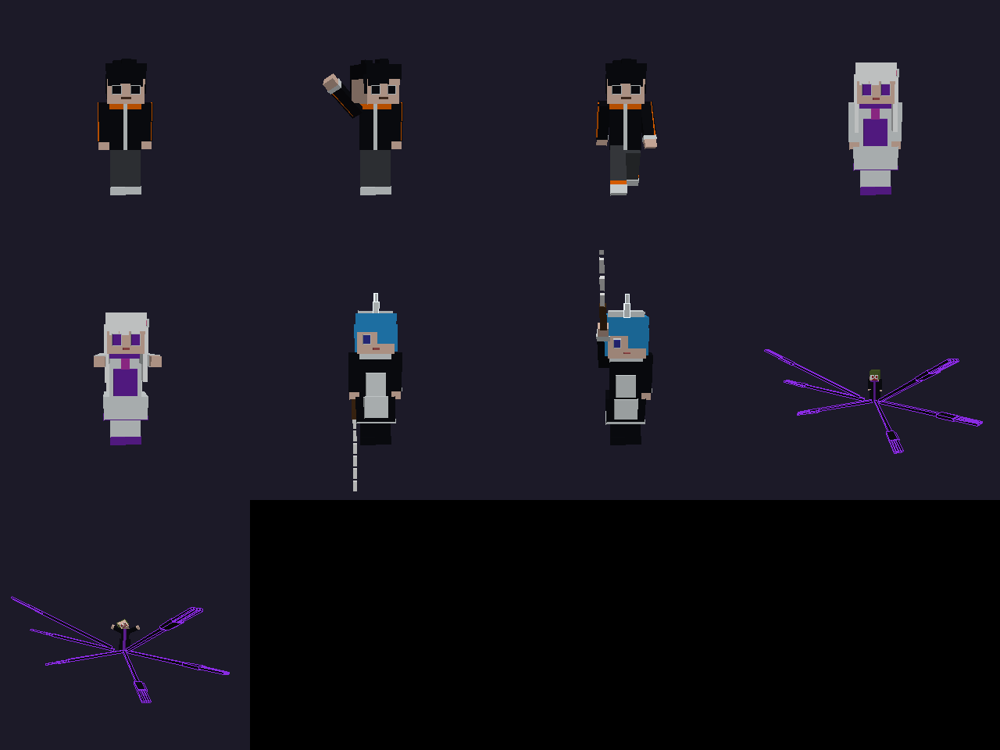

> **В репозитории два проекта:**
> - [`mask-mod/`](mask-mod/README.md) — мод **«Маска Миражей»** (NeoForge 1.21.1): маскировка под мобов и игроков;
> - ниже — датапак-анимация «Re:Блок».

# Re:Блок — «Возвращение смертью»

Анимация в Minecraft в стиле Re:Zero: тела персонажей собраны из **block_display**
(каждая часть тела — отдельный блок с матрицей трансформации и плавной интерполяцией),
эффекты сделаны частицами, звуками и эффектами экрана. Модов не нужно, только датапак.

**Версия: Java Edition 1.21.1** (`pack_format` 48). Проверено на настоящем сервере 1.21.1: все функции
загружаются без ошибок, анимация проигрывается до конца и сама за собой убирает сущности.



`preview/story.mp4` — черновой рендер всей анимации без Minecraft (упрощённая графика,
нужен только чтобы видеть тайминг, камеру и позы).

## Как запустить

1. Скопируй `dist/ReBlock_Animation.zip` в `saves/<мир>/datapacks/` и выполни `/reload`.
2. *(по желанию)* встань на ровное место и выполни `/function rz:build_stage`. Это построит
   средневековую площадь 25×27. **Внимание: команда заменяет блоки в этой области.**
3. Встань в центр и запусти:
   - `/function rz:start` — кино-режим: все игроки становятся зрителями и смотрят через камеру;
   - `/function rz:play` — сцена играет вокруг тебя, а смотреть можно откуда угодно;
   - `/function rz:stop` — прервать. Режимы игры вернутся, а сущности удалятся.

Длительность около 81 секунды. Во время анимации меняется время суток (ночь), в конце ставится 13000.

## Сюжет

| время | сцена | что происходит |
|---|---|---|
| 0:00 | Пролог | Герой в спортивном костюме попадает в другой мир и озирается |
| 0:07 | Встреча | Приходит серебровласая ледяная волшебница, вокруг снег и искры |
| 0:17 | Миазмы | Земля чернеет, из тьмы поднимается безумный жрец: «мой мозг… ДРОЖИТ!» |
| 0:30 | Невидимые руки | Шесть теневых рук с фиолетовым свечением вырываются из его спины |
| 0:35 | Лёд | «Эль Хума!»: ледяной круг, шесть копий, руки сбивают их на подлёте |
| 0:40 | Горничная-они | Прыжок с кистенём, светящийся рог, удар о землю с ударной волной, вращение и удар |
| 0:49 | Удар в спину | Тень пронзает героя, он падает |
| 0:53 | Возвращение смертью | Пустота, сердце бьётся, руки ведьмы сжимают его, шёпот «Я люблю тебя…», вспышка, перемотка времени |
| 1:05 | Снова | Та же сцена и та же реплика. Герой понимает, что вернулся |

## Как это устроено

```
tools/engine.py   матрицы, риги, позы, таймлайн → команды
tools/rigs.py     тела: герой, волшебница, горничная, жрец (+6 рук), руки ведьмы, сердце
tools/story.py    сценарий (все кадры, камера, реплики, эффекты) и сборка датапака
tools/preview.py  софт-рендер: preview/bodies.png и preview/story.mp4
datapack/         собранный датапак (генерируется, руками не править)
dist/             тот же датапак в zip
```

- Все части персонажа стоят в его корневой точке, а форму и позу задаёт полная матрица 4×4
  (`transformation:[16 чисел]`). Она считается в Python как «корень → наклон тела → сустав → коробка».
  В игре остаются только `data merge … {transformation, interpolation_duration}` и
  `tp` с `teleport_duration`, без математики на скорборде.
- Команда уходит только тем частям, у которых матрица реально изменилась.
- Кадры вызываются через двоичное дерево проверок (`rz:d/*`), поэтому за тик выполняется
  около 10 сравнений, а не 540.
- Камера — невидимый `item_display`, игроки в режиме зрителя «вселены» в него через `spectate`.

### Изменить анимацию

Правь `tools/story.py` (позы — словари `P(arm_r=(x,y,z), …)`, время в тиках, 20 тиков = 1 с) и пересобери:

```bash
python3 tools/story.py            # датапак + zip
python3 tools/preview.py          # картинка тел
python3 tools/preview.py --story  # черновое видео (нужен ffmpeg)
```

Углы суставов: `x > 0` — вперёд, `y` — поворот, `z > 0` — в сторону от тела.
У теневых рук четвёртое число — растяжение по длине.
`char.aim(сустав, точка, длина)` сам наводит руку на точку.

Персонажи и сюжет — фанатская стилизация «по мотивам» жанра, а не копия кадров аниме.
