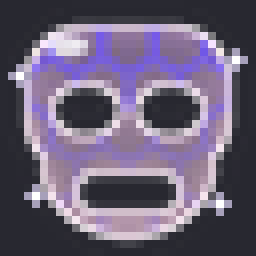
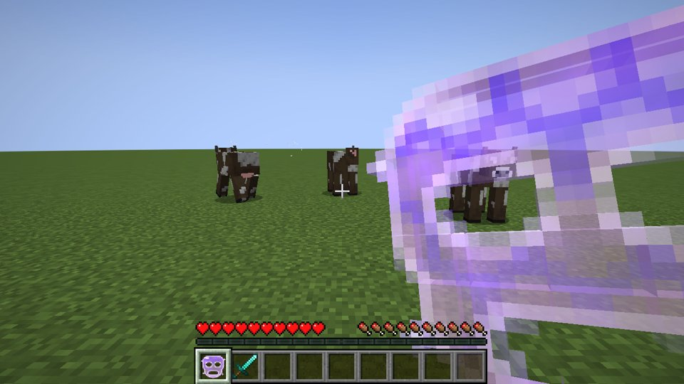
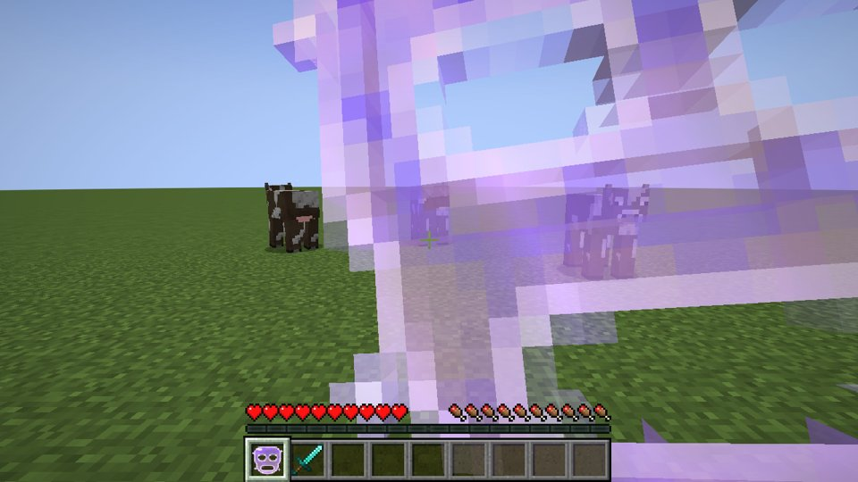
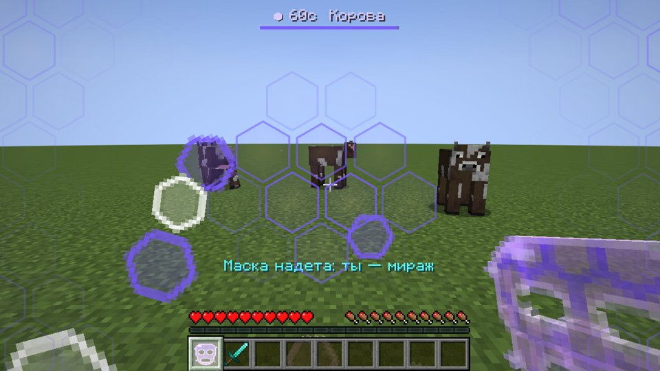
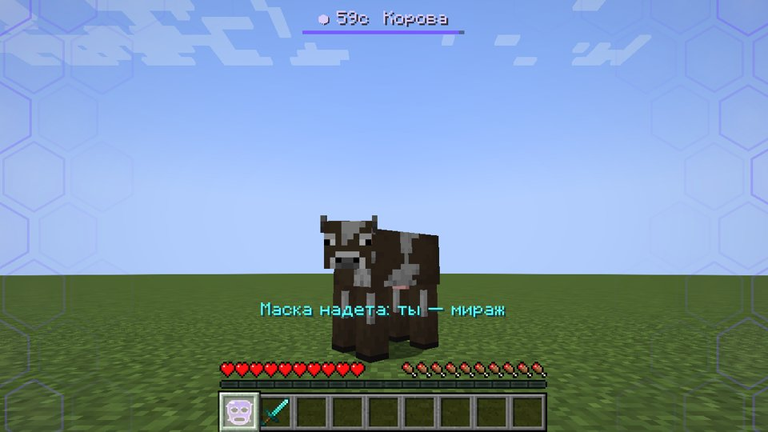
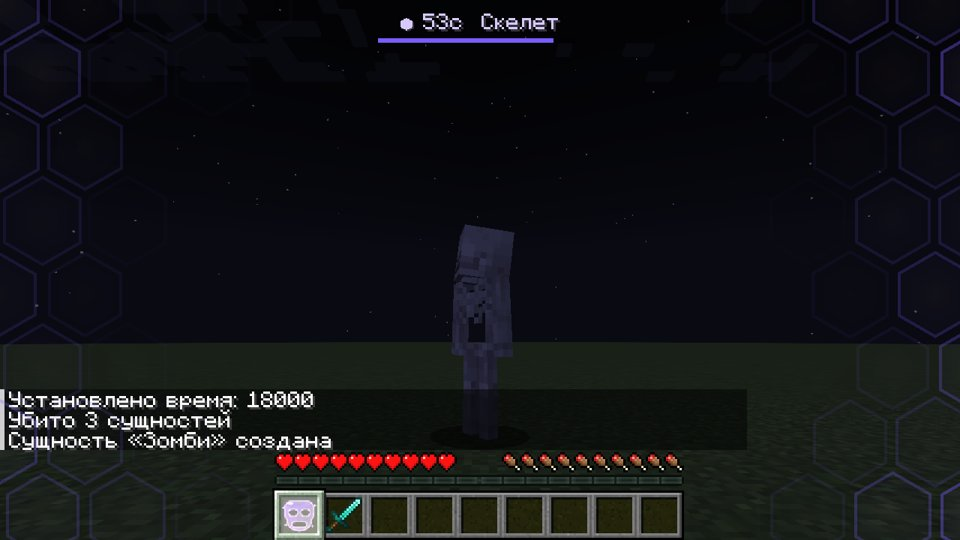
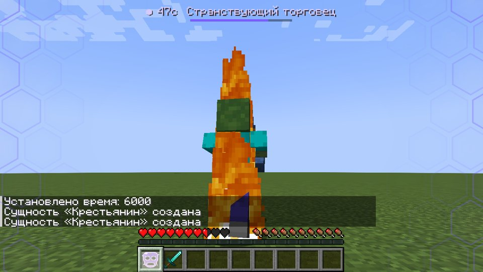
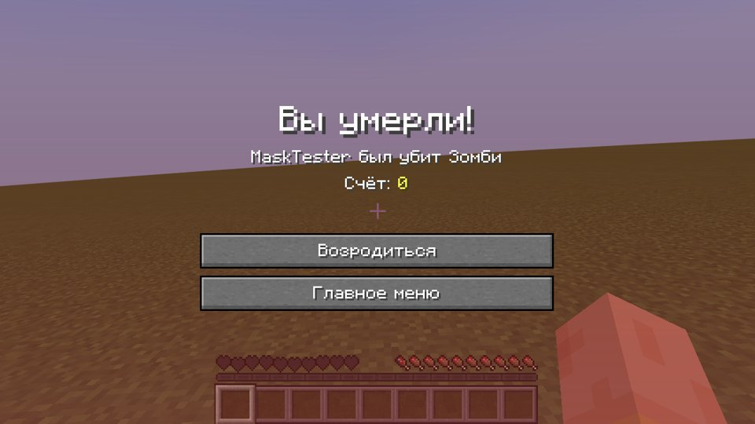
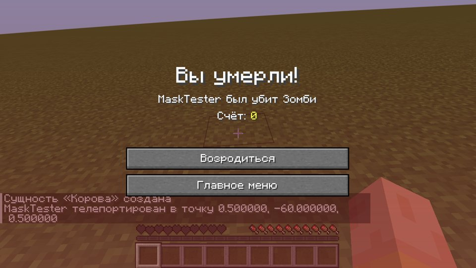

# Маска Миражей (Mirage Mask)

Мод для **Minecraft 1.21.1 / NeoForge** (проверено на 21.1.265). Полупрозрачная розовая маска
с фиолетовыми сотами. Игрок одной рукой надевает её на лицо, по экрану пробегает волна
шестиугольников, и на 60 секунд для всех остальных он превращается в моба, жителя или
копию другого игрока. Облик сам подстраивается под обстановку.



## Установка

Файл `dist/miragemask-neoforge-1.21.1-1.0.0.jar` нужно положить в папку `mods`
**и на сервер, и каждому игроку**. Без мода у игрока не будет ни маскировки, ни эффектов.

## Как пользоваться

1. Скрафти маску (или `/give @s miragemask:mirage_mask`):

   ```
   Аметист  Эхо-осколок  Аметист
   Аметист  Око Эндера   Аметист
            Эхо-осколок
   ```
2. Возьми маску в руку и **держи ПКМ**. Рука за 1 секунду подносит маску к лицу.
3. По экрану проходит волна шестиугольников, по краям экрана остаются соты, а сверху
   показаны таймер и текущий облик.
4. Маска действует **60 секунд**. За 10 секунд до конца края экрана краснеют и пульсируют,
   появляется сообщение «Маска: осталось N сек» и тикает звук.
5. После окончания маска перезаряжается **2 минуты** (полная перезарядка 3 минуты с момента надевания).

## Какой облик выбирает маска

Обстановка проверяется каждые 3 секунды. Если она изменилась, облик меняется со вспышкой сот.

| Обстановка | Облик |
|---|---|
| В радиусе 40 блоков есть игроки | копия **случайного игрока сервера, которого рядом нет**: его скин, ник, броня и предметы в руках |
| Рядом жители или деревня | житель (одежда по биому), изредка странствующий торговец |
| Ночь или пещера | монстр: кто водится рядом, иначе по биому (пустыня — кадавр, снега — зимогор, болото — болотник) |
| В воде | спрут, треска, лосось (ночью утопленник, светящийся спрут) |
| Незер / Энд | зомби-пиглин, пиглин, скелет-иссушитель / эндермен |
| Поле днём | самое частое животное поблизости, чтобы слиться со стадом; если рядом никого нет, то животное по биому |

Остальные игроки видят только этот облик: без ника, без меча, без брони игрока.
Сам игрок от первого лица видит мир как обычно. Если переключиться на вид F5, он увидит свой облик.

**Когда игрок стоит на месте**, кукла ведёт себя как настоящий моб. Она озирается,
поворачивается к проходящим игрокам, животные опускают голову к траве, тело разворачивается
вслед за головой. Всё это происходит, даже если игрок никуда не смотрит. Время от времени
кукла издаёт звуки своего моба: мычит, хрюкает и так далее.

## Как реагируют мобы (по облику)

- В облике **монстра** враждебные мобы тебя не трогают, а железный голем нападает.
- В облике **жителя** нападают зомби, разбойники и вредины, остальные монстры не трогают.
- В облике **животного** монстры не трогают.
- В облике **копии игрока** все мобы ведут себя как с обычным игроком.

## Когда маска слетает

- Удар по кому угодно, выстрел или любой другой урон, нанесённый тобой. Маска рассыпается
  красной вспышкой, появляется надпись «Маска сорвана!».
- Смерть.

## Команды для админов

`/mirage on [игроки]` и `/mirage off [игроки]` (нужен OP 2) включают и выключают маскировку без предмета.

## Что проверено

Всё проверялось автоматическим сценарием в настоящем клиенте 1.21.1 (виртуальный дисплей):

| | |
|---|---|
|  Надевание |  Маска у лица |
|  Волна сот |  Поле → корова (вид F5) |
|  Ночь → зомби |  Деревня → житель |
|  Последние 10 секунд |  Удар → маска сорвана |

В том же прогоне проверено, что ночью в облике зомби настоящий зомби игрока не атакует,
а днём в облике жителя атакует. Мод также запускается на выделенном сервере.

**Не проверено:** превращение в копию другого игрока. Для этого нужны минимум 3 настоящих
игрока на сервере. Код для этого есть, но в игре он не тестировался.

## Ограничения

- Хитбокс остаётся игровым: «курица» по размеру попадания такая же, как игрок.
- Ник игрока по-прежнему виден в списке игроков (Tab).

## Сборка из исходников

```bash
./gradlew build                 # jar в build/libs/
./gradlew runClient             # запустить игру с модом
./gradlew runTestClient         # автоматический сценарий проверки (нужен мир run/testclient/saves/test)
python3 tools/gen_textures.py   # перерисовать текстуры маски и частиц
```

Код теста (`src/devtest`) в готовый jar не попадает.
