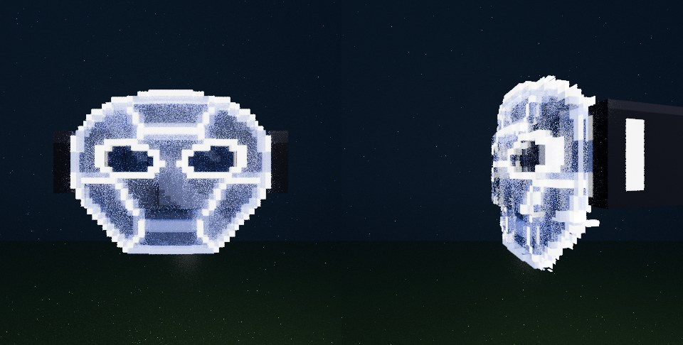
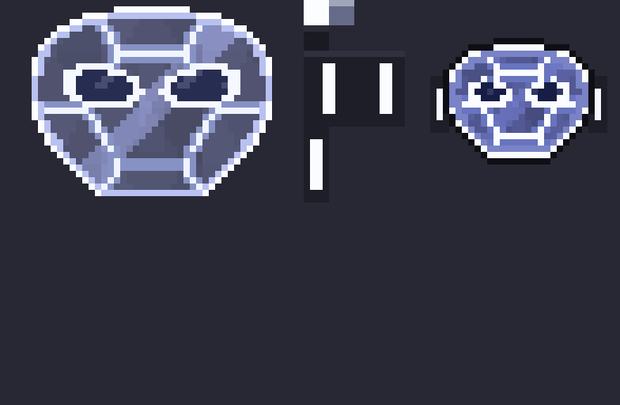
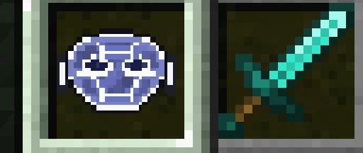
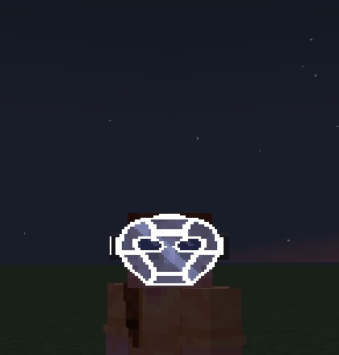
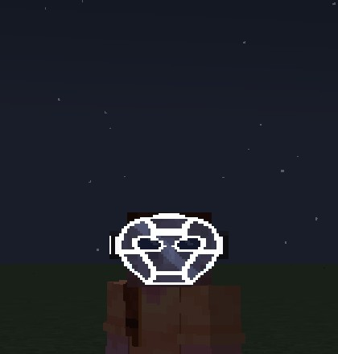
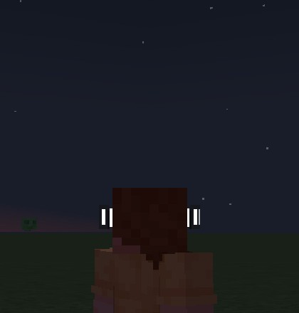
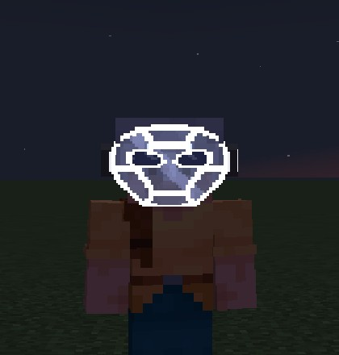
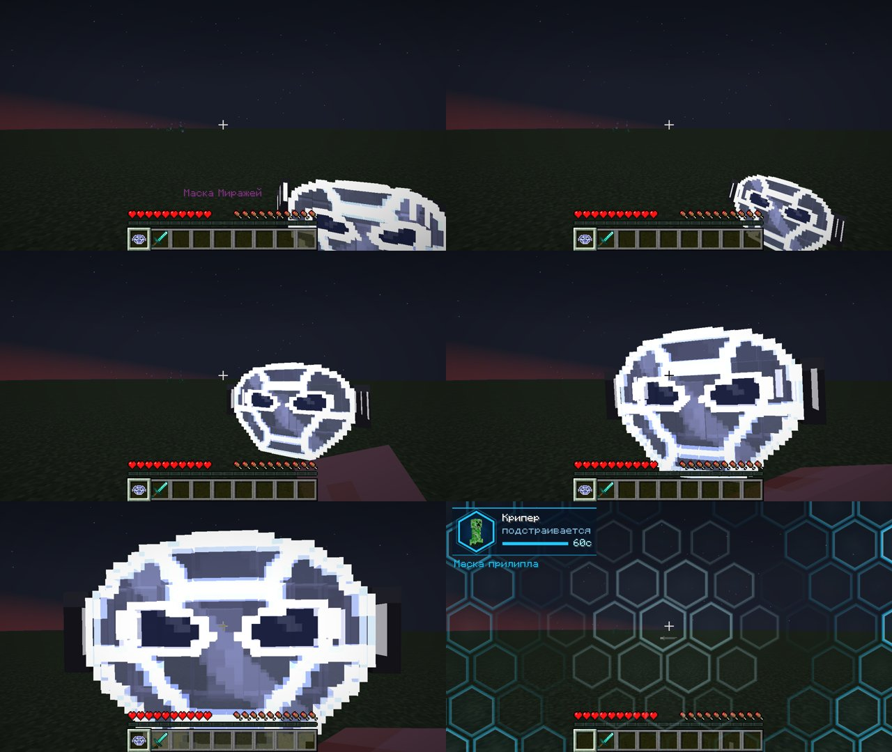
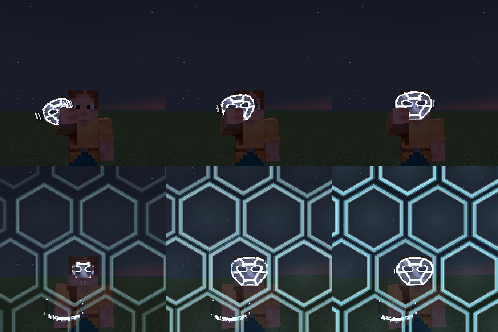

# Маска Миражей (Mirage Mask)

Мод для **Minecraft 1.21.1 / NeoForge** (проверено на 21.1.265). Стеклянная маска в стиле
Blockbench: воксельная модель с пиксель-арт текстурой, сотами и светящимся контуром. Игрок одной рукой прижимает её к лицу, и на 60 секунд
для всех остальных он превращается в моба, жителя или копию другого игрока. Облик сам
подстраивается под обстановку.

## Как выглядит маска

Маска сделана как **модель Blockbench**: воксельная модель из кубов с пиксель-арт текстурой,
в стиле референса. Форма как у настоящей маски: широкие скулы, скруглённый лоб, сужение к
подбородку. Полоски кубов изгибаются вокруг лица: середина выступает, лоб и подбородок уходят
назад, на переносице небольшой выступ. На глазах тёмные линзы в светящейся обводке. Стекло
гранёное, с бликом и сотами; по краю яркий обод; по бокам тёмные крепления со светящимися полосками.



| Текстура 64×64 и иконка 32×32 | Иконка в хотбаре |
|---|---|
|  |  |

На игроке маска видна, когда **маскировка неактивна** (H — «отключить образ») и в момент надевания:

| Спереди | Под углом | Сзади (полоски креплений) | Поверх шлема |
|---|---|---|---|
|  |  |  |  |

### Файлы модели (открываются в Blockbench)

- [`src/main/resources/assets/miragemask/geo/mirage_mask.json`](src/main/resources/assets/miragemask/geo/mirage_mask.json):
  модель в формате **Java Block/Item**, её читает мод. В Blockbench: *File → Open Model*.
- [`tools/blockbench/mirage_mask.bbmodel`](tools/blockbench/mirage_mask.bbmodel): проект Blockbench, текстура встроена.
- Текстуры: `textures/entity/mirage_mask.png` (стекло, соты, обод), `mirage_mask_glow.png`
  (что светится), `textures/item/mirage_mask.png` (иконка).
- Всё это генерирует [`tools/mask_blockbench.py`](tools/mask_blockbench.py) (`python3 tools/mask_blockbench.py`).
  Если правите модель в Blockbench, экспортируйте её как *Java Block/Item* в тот же `geo/mirage_mask.json`.
  Мод и сцена Blender подхватят изменения сами.

Координаты модели как в Blockbench: голова игрока — куб (4,0,4)–(12,8,12), лицо на z = 4.

## Анимация надевания (Blender)

Анимация от первого лица сделана в **Blender**: [`tools/blender/put_on_animation.py`](tools/blender/put_on_animation.py)
строит сцену, а [`tools/blender/mask_put_on.blend`](tools/blender/mask_put_on.blend) можно открыть и поправить руками.

- Камера в сцене — это глаза игрока (FOV 70°, как рука в Minecraft). Рука стоит в тех же
  координатах, что настоящая рука от первого лица.
- Ключевые кадры: рука с маской поднимается снизу справа, разворачивает маску к лицу,
  прижимает её, маска сплющивается о лицо и с отскоком «прилипает».
- Скрипт выгружает анимацию в мод: `assets/miragemask/animations/put_on_first_person.json`,
  матрицу руки и маски на каждый тик. В игре рука рисуется со скином игрока и проигрывает
  эти кадры с плавной интерполяцией.

| Превью из Blender | В игре |
|---|---|
| [`docs/blender/put_on_first_person_blender.mp4`](docs/blender/put_on_first_person_blender.mp4) ([замедленно](docs/blender/put_on_first_person_blender_slow.mp4)) | [`docs/video/fp_put_on_first_person.mp4`](docs/video/fp_put_on_first_person.mp4) |



**Со стороны** другие видят, как рука поднимает маску к глазу, маска уходит из руки на лицо,
соты прилипают от центра к краям, и только потом игрок превращается.
Видео: [`docs/video/tp_put_on_front.mp4`](docs/video/tp_put_on_front.mp4), [`docs/video/tp_stick_front.mp4`](docs/video/tp_stick_front.mp4).



Чтобы изменить анимацию, правь ключевые кадры `KEYS` в скрипте и запусти его заново:
```bash
pip install bpy==5.2.3              # Blender как модуль Python (или запусти через сам Blender)
python tools/blender/put_on_animation.py              # сцена + экспорт в мод + превью
python tools/blender/put_on_animation.py --no-render  # только экспорт
```
Маску сцена Blender берёт из той же модели Blockbench (`geo/mirage_mask.json` + текстуры).

## Установка

Файл `dist/miragemask-neoforge-1.21.1-1.0.0.jar` нужно положить в папку `mods`
**и на сервер, и каждому игроку**.

## Как пользоваться

1. Скрафти маску (или `/give @s miragemask:mirage_mask`):

   ```
   Аметист  Эхо-осколок  Аметист
   Аметист  Око Эндера   Аметист
            Эхо-осколок
   ```
2. Возьми маску в руку и **держи ПКМ** (1 секунда). Анимацию надевания см. выше.
3. **Маска уходит из руки на лицо.** Когда действие закончится или маску сорвут, она
   возвращается в инвентарь. Если инвентарь полон, она падает рядом.
4. Маска действует **60 секунд**. Перезарядка 2 минуты после окончания.

### HUD

В левом верхнем углу небольшая панель: шестиугольная рамка с живой фигуркой текущего облика,
его название, режим («подстраивается» / «закреплён [G]» / «лицо открыто [H]»), таймер.
В последние 10 секунд всё краснеет. Под панелью коротко всплывают события.

### Две функции маски (клавиши переназначаются в «Управлении» → «Маска Миражей»)

| Клавиша | Функция | Что происходит |
|---|---|---|
| **G** | **Оставить образ** | Облик закрепляется и не меняется по обстановке |
| **H** | **Отключить образ** | Маскировка на паузе, но не теряется. Все видят тебя с маской на лице, мобы видят обычного игрока, удары маску не срывают. Повторное H возвращает образ |

Таймер во время паузы идёт.

## Галерея: все облики (вид со стороны)

Все 52 облика сняты в игре: так тебя видят другие игроки, в углу HUD этого облика.

| Категория | Когда выбирается | Лист |
|---|---|---|
| Поле (22) | день, открытое место; самое частое животное рядом или животное по биому | [лист](docs/gallery/sheet_1_field.jpg) |
| Деревня (2) | рядом жители или деревня | [лист](docs/gallery/sheet_2_village.jpg) |
| Монстры (13) | ночь или пещера | [лист](docs/gallery/sheet_3_hostile.jpg) |
| Незер (7) | в Незере | [лист](docs/gallery/sheet_4_nether.jpg) |
| Вода (7) | игрок в воде | [лист](docs/gallery/sheet_5_water.jpg) |
| Копия игрока | рядом игроки: копия случайного игрока, которого рядом нет | [лист](docs/gallery/sheet_6_player_copy.jpg) |

## Поведение маскировки

- Обстановка проверяется каждые 3 секунды. Если она изменилась и образ не закреплён,
  облик меняется.
- Остальные видят только облик: без ника, меча и брони.
- Когда игрок стоит на месте, облик ведёт себя как моб: озирается, смотрит на проходящих,
  животные опускают голову к траве, иногда звучат голоса моба.
- Мобы реагируют по облику. В облике монстра монстры не трогают, а голем нападает.
  В облике жителя нападают зомби и разбойники.
- Удар, выстрел или урон, нанесённый тобой (кроме режима H), срывает маску: соты разлетаются с лица.

## Команды для админов (OP 2)

| Команда | Что делает |
|---|---|
| `/mirage on [игроки]` / `/mirage off [игроки]` | включить / снять маскировку |
| `/mirage as <моб>` | конкретный облик (сразу закрепляется), например `/mirage as minecraft:fox` |
| `/mirage copy <игрок>` | стать копией игрока |
| `/mirage reset` | сбросить перезарядку маски |

## Что проверено

Автоматическим сценарием в настоящем клиенте 1.21.1:
- анимация надевания от первого лица (кадры из Blender);
- надевание и прилипание со стороны;
- маска на лице спереди, сбоку, сзади и поверх шлема;
- иконка в хотбаре;
- галерея из 52 обликов;
- вокруг облика больше нет плавающих частиц.

Ранее там же проверены G/H, срыв маски, возврат в инвентарь, реакция мобов и запуск на
выделенном сервере.

**Не проверено вживую:** автоматический выбор копии *другого* игрока (нужны минимум 3 игрока).

## Ограничения

- Хитбокс остаётся игровым.
- Ник виден в списке игроков (Tab).
- Рука в анимации от первого лица — классическая «широкая». Со «стройным» скином рука на
  пиксель уже, чем в Blender.

## Сборка из исходников

```bash
./gradlew build                          # jar в build/libs/
./gradlew runClient                      # игра с модом
./gradlew runTestClient                  # авто-сценарий: маска, анимация, вид со стороны
./gradlew runTestClient -Pmode=gallery   # авто-сценарий: галерея всех обликов
```
(Для авто-сценариев нужен мир `run/testclient/saves/test` с разрешёнными командами.
Код теста в готовый jar не попадает.)
