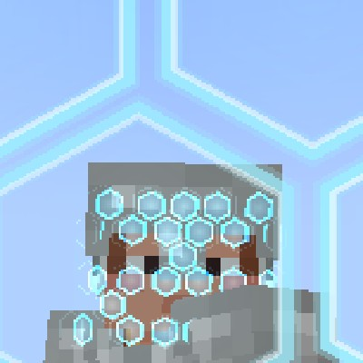
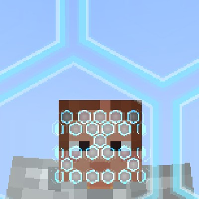
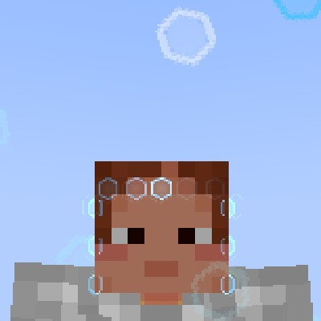
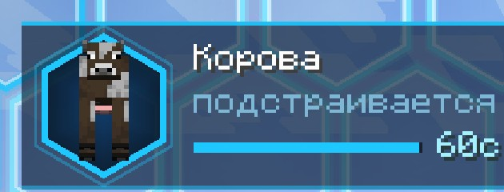

# Маска Миражей (Mirage Mask)

Мод для **Minecraft 1.21.1 / NeoForge** (проверено на 21.1.265). Маска из **светящихся голубых
шестиугольников энергии**. Игрок одной рукой прижимает её к лицу, соты «прилипают» к лицу,
и на 60 секунд для всех остальных он превращается в моба, жителя или копию другого игрока.
Облик сам подстраивается под обстановку.

| Шлем + маска (поверх шлема) | Без шлема — только лицо | Лицо открыто (H) |
|---|---|---|
|  |  |  |

Маска лежит **только на лице**: от бровей до подбородка и от щеки до щеки, глаза и рот открыты,
макушка и виски не закрыты. Если на игроке шлем, маска надевается поверх шлема.

## Видео (записаны в игре, вид со стороны)

- [`docs/video/01_transform_from_outside.mp4`](docs/video/01_transform_from_outside.mp4):
  игрок в броне поднимает руку с маской к лицу, соты прилипают, он превращается в корову и
  идёт, затем стоит и озирается как моб.
- [`docs/video/02_reveal_and_resume.mp4`](docs/video/02_reveal_and_resume.mp4):
  H открывает лицо (остаётся ободок сот), H снова возвращает образ.
- [`docs/video/03_break.mp4`](docs/video/03_break.mp4):
  удар срывает маску, соты разлетаются, маска возвращается в инвентарь.

## Установка

Файл `dist/miragemask-neoforge-1.21.1-1.0.0.jar` нужно положить в папку `mods`
**и на сервер, и каждому игроку**.

## Как пользоваться

1. Скрафти маску (или `/give @s miragemask:mirage_mask`):

   ```
   Аметист  Эхо-осколок  Аметист
   Аметист  Око Эндера   Аметист
            Эхо-осколок
   ```
2. Возьми маску в руку и **держи ПКМ**. Рука подносит маску к лицу, соты прилипают от центра
   лица к краям, на экране короткая вспышка сот и лёгкая тряска.
3. **Маска уходит из руки на лицо.** Когда действие закончится или маску сорвут, она
   возвращается в инвентарь. Если инвентарь полон, она падает рядом.
4. Маска действует **60 секунд**. Перезарядка 2 минуты после окончания.

### HUD вместо сообщений



В левом верхнем углу показана небольшая панель:
- шестиугольная рамка с **живой фигуркой текущего облика**;
- название облика (моб или ник копии игрока);
- режим: «подстраивается» / «закреплён [G]» / «лицо открыто [H]»;
- полоска таймера и секунды. В последние 10 секунд всё краснеет и пульсирует.

Под панелью коротко всплывают события: «Маска прилипла», «Новый облик», «Лицо открыто»,
«Образ закреплён», «Маска сорвана!». Сообщений над хотбаром больше нет.

### Две функции маски (клавиши можно переназначить в «Управлении» → «Маска Миражей»)

| Клавиша | Функция | Что происходит |
|---|---|---|
| **G** | **Оставить образ** | Облик закрепляется и не меняется по обстановке. Повторное нажатие снимает фиксацию |
| **H** | **Отключить образ** | Маскировка на паузе, но не теряется. Видно твоё лицо с ободком сот, мобы видят обычного игрока, удары маску не срывают. Повторное нажатие возвращает образ |

Таймер во время паузы продолжает идти.

## Галерея: все облики маски (вид со стороны)

Это все мобы, в которых маска умеет превращать. Всё снято в игре: так тебя видят другие
игроки. Слева вверху на каждом кадре HUD этого облика.

| Категория | Когда выбирается | Листы |
|---|---|---|
| Поле (22) | день, открытое место; самое частое животное поблизости или животное по биому | [лист](docs/gallery/sheet_1_field.jpg) |
| Деревня (2) | рядом жители или деревня | [лист](docs/gallery/sheet_2_village.jpg) |
| Монстры (13) | ночь или пещера; кто водится рядом, иначе по биому | [лист](docs/gallery/sheet_3_hostile.jpg) |
| Незер (7) | в Незере | [лист](docs/gallery/sheet_4_nether.jpg) |
| Вода (7) | игрок в воде | [лист](docs/gallery/sheet_5_water.jpg) |
| Копия игрока | рядом есть игроки: копия случайного игрока, которого рядом нет (скин, ник, броня, предметы) | [лист](docs/gallery/sheet_6_player_copy.jpg) |

Отдельные кадры лежат в [`docs/gallery/`](docs/gallery/) (`g01_field_cow.jpg` … `g52_player_copy.jpg`).

**Поле:** корова, свинья, овца, курица, лошадь, осёл, мул, коза, кролик, лиса, лама, верблюд,
лягушка, муушрум, волк, кошка, оцелот, панда, белый медведь, броненосец, черепаха, попугай.
**Деревня:** житель (одежда по биому), странствующий торговец.
**Монстры:** зомби, скелет, крипер, паук, кадавр, зимогор, утопленник, эндермен, ведьма,
болотник, зомби-житель, пещерный паук, разбойник.
**Незер:** зомбифицированный пиглин, пиглин, брутальный пиглин, хоглин, визер-скелет, лавомерка, ифрит.
**Вода:** спрут, светящийся спрут, треска, лосось, дельфин, тропическая рыба, аксолотль.
**Энд:** эндермен.

## Поведение маскировки

- Обстановка проверяется каждые 3 секунды. Если она изменилась (и образ не закреплён),
  облик меняется со вспышкой сот.
- Остальные видят только облик: без ника, меча и брони игрока.
- Когда игрок стоит на месте, кукла ведёт себя как моб: озирается, смотрит на проходящих,
  животные опускают голову к траве, иногда звучат голоса моба.
- Вокруг облика изредка всплывают едва заметные голубые соты, это аура маски.
- Мобы реагируют по облику. В облике монстра монстры не трогают, а голем нападает.
  В облике жителя нападают зомби и разбойники. В облике копии игрока мобы ведут себя как обычно.
- Удар, выстрел или любой урон, нанесённый тобой (кроме режима «лицо открыто»), срывает маску.
  Смерть тоже.

## Команды для админов (OP 2)

| Команда | Что делает |
|---|---|
| `/mirage on [игроки]` | включить маскировку без предмета |
| `/mirage off [игроки]` | снять маскировку |
| `/mirage as <моб>` | надеть конкретный облик (он сразу закрепляется), например `/mirage as minecraft:fox` |
| `/mirage copy <игрок>` | стать копией указанного игрока |

## Что проверено

Всё снято автоматическим сценарием в настоящем клиенте 1.21.1 (виртуальный дисплей): видео,
галерея из 52 обликов, прилипание со шлемом и без, режим H, срыв, возврат маски, HUD.
Ранее там же проверены G (закрепление облика ночью), реакция зомби на облик и запуск на
выделенном сервере.

**Не проверено вживую:** автоматический выбор копии *другого* игрока (нужны минимум 3 игрока).
Сама отрисовка копии проверена командой `/mirage copy` на себе: ник, скин, броня и предметы
отображаются.

## Ограничения

- Хитбокс остаётся игровым: «курица» по размеру попадания такая же, как игрок.
- Ник игрока по-прежнему виден в списке игроков (Tab).
- Мелкие рыбы в воде видны плохо (они и в ванилле маленькие).

## Сборка из исходников

```bash
./gradlew build                 # jar в build/libs/
./gradlew runClient             # запустить игру с модом
./gradlew runTestClient         # автоматический сценарий: видео + галерея (нужен мир run/testclient/saves/test)
python3 tools/gen_textures.py   # перерисовать 2D-текстуры (частица, иконка-частица)
```

Код теста (`src/devtest`) в готовый jar не попадает.
