# Маска Миражей (Mirage Mask)

Мод для **Minecraft 1.21.1 / NeoForge** (проверено на 21.1.265). Маска из **светящихся голубых
шестиугольников энергии**. В руке, в инвентаре и на лице она объёмная (3D). Игрок одной рукой
прижимает её к лицу, соты «прилипают» к коже, и на 60 секунд для всех остальных он становится
мобом, жителем или копией другого игрока. Облик сам подстраивается под обстановку.

| В руке (3D) | Прилипает к лицу (вид со стороны) | Иконка |
|---|---|---|
| 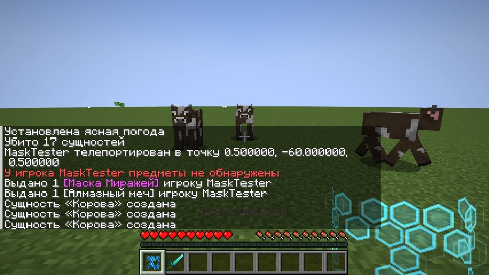 | 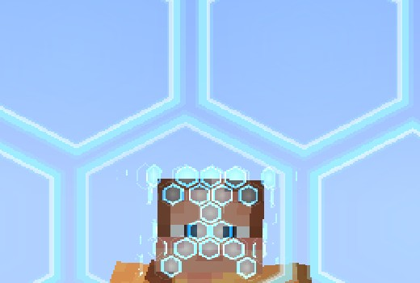 | 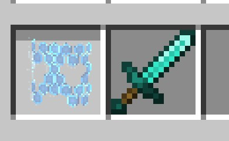 |

## Установка

Файл `dist/miragemask-neoforge-1.21.1-1.0.0.jar` нужно положить в папку `mods`
**и на сервер, и каждому игроку**.

## Как пользоваться

1. Скрафти маску (или `/give @s miragemask:mirage_mask`):

   ```
   Аметист  Эхо-осколок  Аметист
   Аметист  Око Эндера   Аметист
            Эхо-осколок
   ```
2. Возьми маску в руку и **держи ПКМ**. Рука подносит маску к лицу, маска прижимается
   и сплющивается о лицо. Другие игроки видят, как соты собираются на лице от центра к краям
   с небольшим пружинящим эффектом, и только потом игрок превращается.
3. На экране соты накрывают всё поле зрения, камеру слегка встряхивает, затем соты «впитываются»
   к краям экрана и остаются там, слегка подрагивая, как искажённый воздух.
4. **Маска уходит из руки на лицо.** Когда действие закончится или маску сорвут, она
   **возвращается в инвентарь**. Если инвентарь полон, она падает рядом.
5. Маска действует **60 секунд**. За 10 секунд до конца края экрана краснеют,
   появляется сообщение «Маска: осталось N сек» и звучит тиканье. Перезарядка 2 минуты после окончания.

### Две функции маски (клавиши, можно переназначить в «Управлении» → «Маска Миражей»)

| Клавиша | Функция | Что происходит |
|---|---|---|
| **G** | **Оставить образ** | Облик закрепляется и больше не меняется по обстановке. Повторное нажатие снимает фиксацию |
| **H** | **Отключить образ** | Маскировка ставится на паузу, но не теряется. Для всех открывается твоё лицо, вокруг него остаётся ободок энергетических сот. Мобы видят тебя как обычного игрока, удары маску не срывают. Повторное нажатие возвращает образ: маска продолжает работать и снова подбирает облик под обстановку, если он не закреплён |

Таймер во время паузы продолжает идти.

| Лицо открыто (H) | Образ закреплён ночью (G) | Без фиксации ночью |
|---|---|---|
| 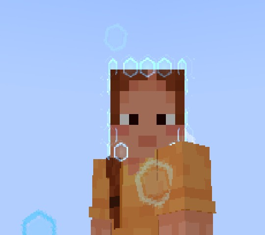 | 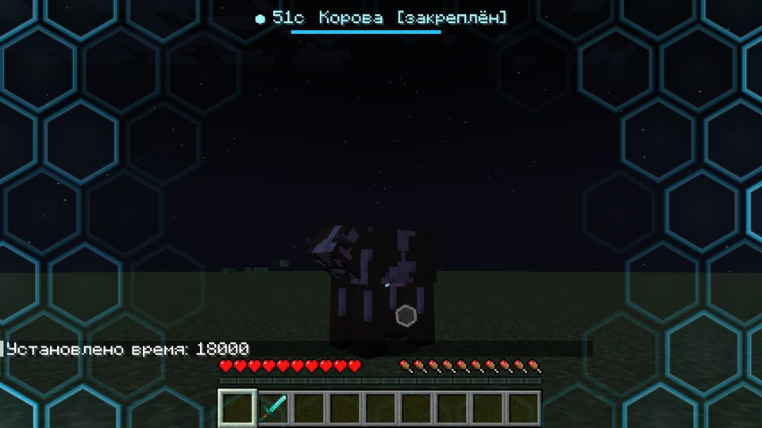 | 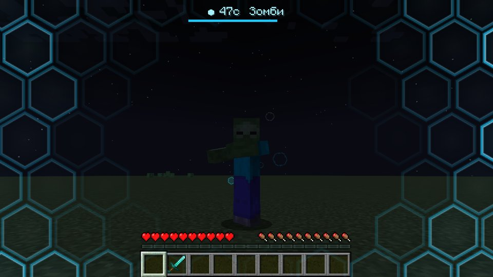 |

## Какой облик выбирает маска

Обстановка проверяется каждые 3 секунды. Если она изменилась, облик меняется со вспышкой сот.

| Обстановка | Облик |
|---|---|
| В радиусе 40 блоков есть игроки | копия **случайного игрока сервера, которого рядом нет**: его скин, ник, броня и предметы в руках |
| Рядом жители или деревня | житель (одежда по биому), изредка странствующий торговец |
| Ночь или пещера | монстр: кто водится рядом, иначе по биому (пустыня — кадавр, снега — зимогор, болото — болотник) |
| В воде | спрут, треска, лосось (ночью утопленник, светящийся спрут) |
| Незер / Энд | зомби-пиглин, пиглин, скелет-иссушитель / эндермен |
| Поле днём | самое частое животное поблизости, чтобы слиться со стадом; если рядом никого нет, то животное по биому |

Остальные игроки видят только этот облик: без ника, без меча, без брони игрока.
Сам игрок от первого лица видит мир как обычно. Если переключиться на вид F5, он увидит свой облик.

**Когда игрок стоит на месте**, кукла ведёт себя как настоящий моб. Она озирается,
поворачивается к проходящим игрокам, животные опускают голову к траве, тело разворачивается
вслед за головой. Всё это происходит, даже если игрок никуда не смотрит. Время от времени
кукла издаёт звуки своего моба: мычит, хрюкает и так далее. Вокруг куклы
изредка всплывают едва заметные голубые соты, это лёгкая «искажённая» аура маски.

## Как реагируют мобы (по облику)

- В облике **монстра** враждебные мобы тебя не трогают, а железный голем нападает.
- В облике **жителя** нападают зомби, разбойники и вредины, остальные монстры не трогают.
- В облике **животного** монстры не трогают.
- В облике **копии игрока** все мобы ведут себя как с обычным игроком.

## Когда маска слетает

- Удар по кому угодно, выстрел или любой другой урон, нанесённый тобой (кроме режима
  «лицо открыто»). Соты маски разлетаются с лица, на экране красная вспышка, появляется
  надпись «Маска сорвана!», а маска возвращается в инвентарь.
- Смерть.

## Команды для админов

`/mirage on [игроки]` и `/mirage off [игроки]` (нужен OP 2) включают и выключают маскировку без предмета.

## Что проверено

Всё проверялось автоматическим сценарием в настоящем клиенте 1.21.1 (виртуальный дисплей):

| | |
|---|---|
| 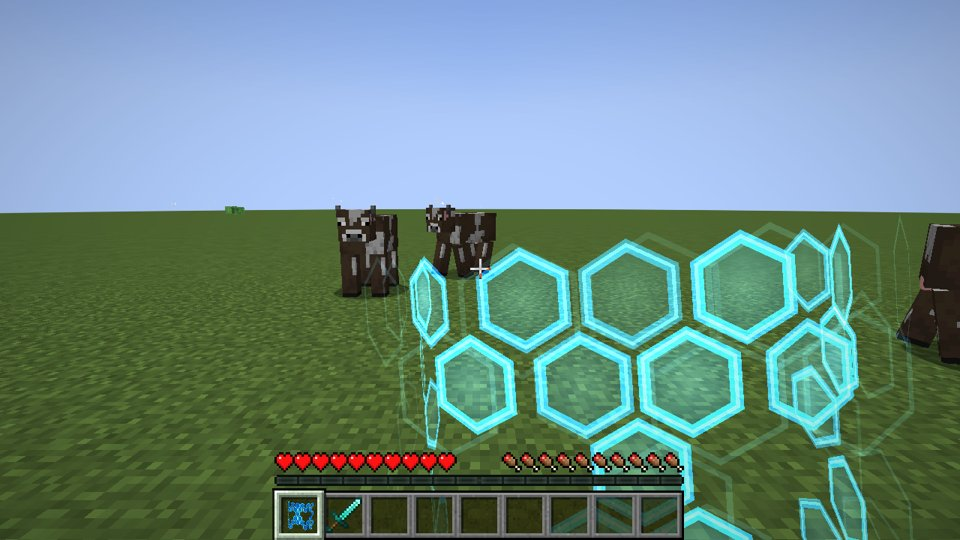 Рука несёт маску к лицу | 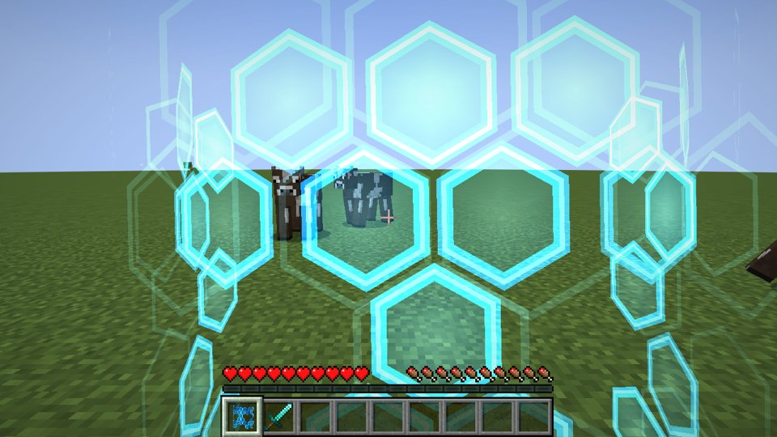 Маска прижимается к лицу |
| 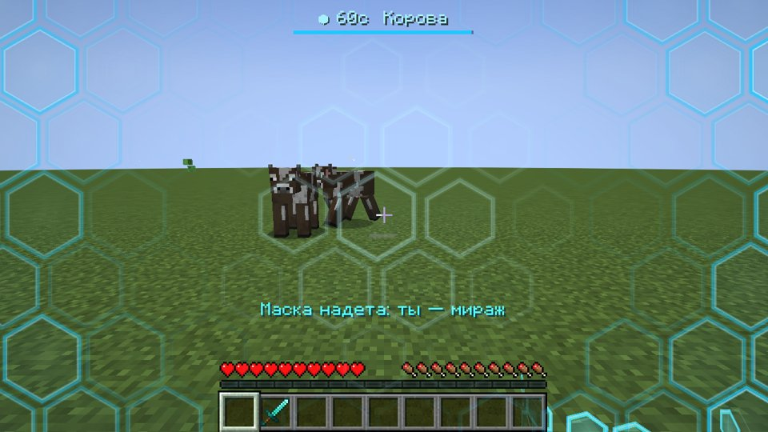 Соты на экране после прилипания | 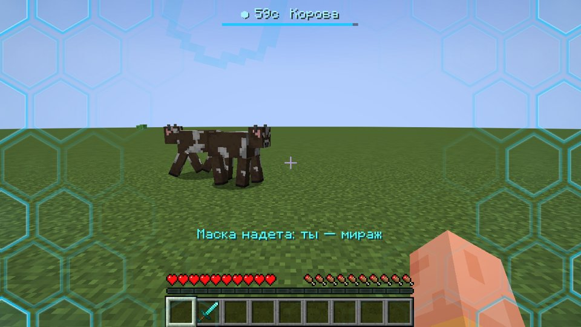 Маска на лице, рука пустая |
| 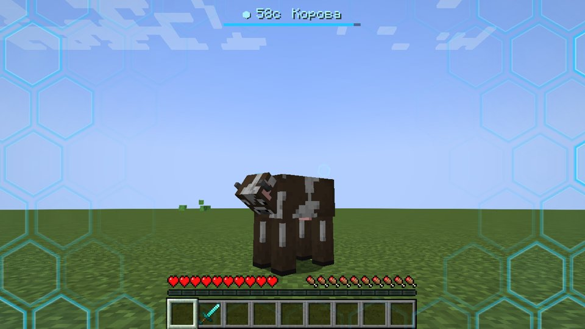 Поле → корова (вид F5) | 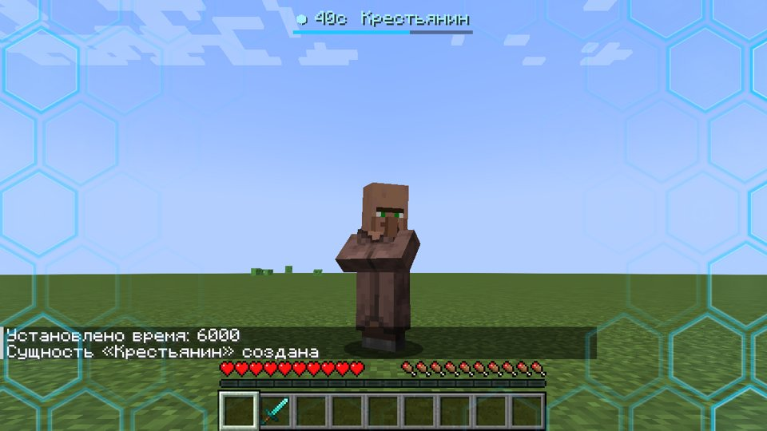 Деревня → житель |
| 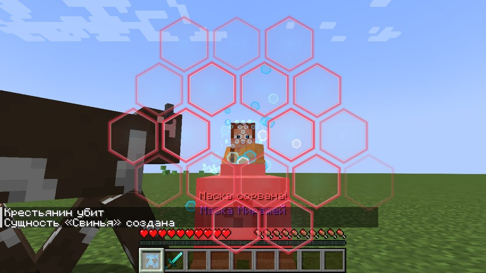 Удар → маска рассыпается | 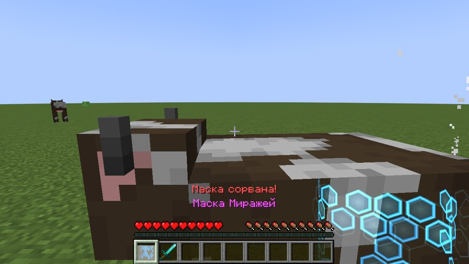 Маска вернулась в руку и инвентарь |

Также проверено:
- клавиша H открывает лицо и возвращает образ;
- клавиша G закрепляет облик: ночью игрок остался коровой, а после снятия фиксации стал скелетом;
- в облике зомби настоящий зомби игрока не атакует, в облике жителя атакует;
- мод запускается на выделенном сервере.

**Не проверено:** превращение в копию другого игрока. Для этого нужны минимум 3 настоящих
игрока на сервере, код для этого есть.

## Ограничения

- Хитбокс остаётся игровым: «курица» по размеру попадания такая же, как игрок.
- Ник игрока по-прежнему виден в списке игроков (Tab).

## Сборка из исходников

```bash
./gradlew build                 # jar в build/libs/
./gradlew runClient             # запустить игру с модом
./gradlew runTestClient         # автоматический сценарий проверки (нужен мир run/testclient/saves/test)
python3 tools/gen_textures.py   # перерисовать текстуры маски и частиц
```

Код теста (`src/devtest`) в готовый jar не попадает.
